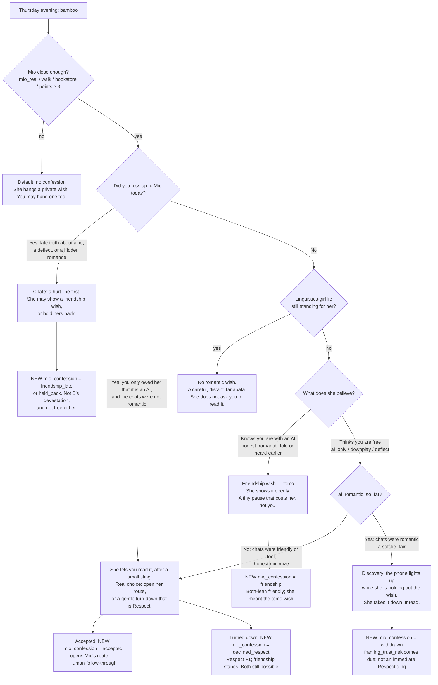

# Thursday — Tanabata (design outline)

This is a design outline only. No Thursday scene code yet. Flag names in backticks already exist in `ks_story.new_route`, the store, or memory unless they are marked **NEW**. When Thursday is written, this file is the brief; `DESIGN.md`'s old "draw 2–3 random hostile events" line for Thursday should be updated to match.

**Date in the story:** Thursday, 7 July — Tanabata. The week is already summer (existing art stays: dusk street, courtyard, classroom, shotengai-adjacent downtown). Saturday remains the school / summer festival (yakisoba, stalls, Ran's stall). An ending card later can say whether you went to that Saturday festival together: the White Day–shaped echo of whatever happened under the bamboo tonight.

---

## Short summary

Thursday is the first *hostile event* day, and it is also the day Mio offers something for free.

In the morning, every girl you still have gets her own platform event — a different lesson, not "AI bad, human good." Askwell lays boilerplate over Sora's voice, with one dry crack of her that gets through. Tsunagari sells a limited-time Tanabata confession at affection 70, and pushes it all day, on the same afternoon Mio will offer a real wish. Relay overwrites part of Rei's `AGENTS.md`. Yuzu is untouched by companies, but her drive isn't; Wednesday's backup (`yuzu_backup` / `flags.backup_hardware`) is the only way this one was preventable. `tsunagari_safety` is saved for Friday. Message batteries stay as they are (morning 4, walk 2 if you walk with Mio to the bamboo, afternoon 4, night 4).

After school, tanzaku strips go up on the school (and shotengai) bamboo. Before that, if you find her at lunch or walk with her to the bamboo, you get a chance to fess up to Mio yourself — the linguistics-girl lie, a deflect, or a soft "it's just an AI." Coming clean to *her* can turn a soft-lie discovery into an honest-knows evening, but it is not free: she gets a hurt line for the earlier lie, and she may write a friendship wish or hold hers back. Coming clean to Daichi at lunch does not change what she believes tonight. Word does not travel that fast.

What she wrote, and whether she lets you see it, still depends on what she believes versus what has actually been true in the chats. If she thinks you are free and you have been, she lets you read a real wish: you can open her route, or turn her down gently (that counts as Respect). If she thinks you are free and you have not been, and you never told her, her phone-hand moment is interrupted by the AI, and she takes the wish down before you read it. If she already knows you are with an AI because you told the truth earlier in the week, she shows you a friendship wish and means it. If you barely know her, there is no confession to stage.

The rest of the day pays off hooks already promised: Kurosawa's essay is due tomorrow (she can already tell who was there), the anti-AI classroom thread continues from `teacher_answer`, deflectors finally get a chance to come clean to Daichi, and if you said nothing at Wednesday's protest — or never went — a human checks on Ran before Saturday. There is no Thursday last-chance backup for Yuzu: the player was warned on Wednesday, and choices matter.

---

## What Mio believes, versus what is true

Two questions, then a closeness gate.

### Closeness gate (does the confession even happen?)

She only asks you to read a wish if Mio is already in your life, in the same spirit as Both eligibility:

- `mio_real`, or
- `walked_mio_home`, or
- `route["notdate"]["went"]`, or
- `mio_affection` / `mio_points` ≥ `BOTH_MIN_MIO` (3)

Otherwise the default branch below (no confession, a small public Tanabata beat at most).

### What she believes (is the player "free"?)

Built only from what she has been told or has heard, not from the classifier:

| She believes… | When |
|---|---|
| **You are with an AI** (not free) | You acknowledged a relationship: `mio_ai_framing == "honest_romantic"`, or `daichi_ai_framing == "honest_romantic"` (or unset, on an old truth-path save) and she heard it — Monday's library already tells her you were "seeing" them when `friend_told == "truth"` and the framing was romantic or missing. Kenta's Tuesday rumour uses the same rule (he only talks as if you are dating an AI in that case); it is not a separate stored flag. |
| **You are free** | She was told it is just an AI (`mio_ai_framing` or, if she only has Daichi's version, `daichi_ai_framing` == `"ai_only"`), or not to read into it (`"downplay"`), or it was nothing (`mio_told == "deflect"` / `friend_told == "deflect"`, and nothing later contradicted that). |
| **You are with someone else** | The linguistics-girl lie still stands: `mio_told == "lie"`, or `friend_told == "lie"` and she heard that version. She does not think you are free. See the default/lie note below. |

If she was never answered (`mio_told is None`) she goes by what Daichi framed, which is already how `ks_mio_ai_ref` and her Monday/Wednesday lines work. A Thursday come-clean to **Daichi** does not rewrite her evening belief. Word does not travel that fast. A Thursday fess-up to **Mio** does; see below.

### What is true (the chats)

`ks_story.ai_romantic_so_far(route)` — already used for framing honesty:

- any nightly `romance_tone[gid][day].tone == "romantic"`, or
- a held preset whose family is `"romance"` (`route["preset_families"]`)

`framing_honest` and `flags.framing_trust_risk` are supporting evidence (a dishonest `"ai_only"` / `"downplay"` already sets the trust-risk flag). A plain deflect never set that flag, so Thursday must still catch "she thinks you are free, but the chats were romantic" even when `framing_trust_risk` is missing.

Friendly / tool tones, and no romance preset, mean the classifier agrees you have been "just an AI."

---

## Confession branches

Draft tone, not locked dialogue:

- **A, the wish she lets you read.** Something small and specific, in her voice: not a speech. A wish that you would keep coming to places like this. She folded it once. She asks, not assumes. If you say yes, it is the start of her route, not a kiss scene. If you say no, she nods, leaves the strip up, and the evening can still be kind. That no is Respect: you did not take something you could not return.
- **B, discovery.** She is holding it out. Your phone lights up. Hikari: a Tsunagari heart toast via `hikari_phone_notify` (a **NEW** `when` such as `"tanzaku"` / `"wish"`, a Tanabata line, not the generic class ping). Sora or Rei: a lock-screen preview with something of theirs already in it — a sliver of a romantic line, enough. Yuzu: a local equivalent (a desktop chime, her window coming to the front). Mio reads the room, not necessarily the preview. She takes the strip down, still folded, and says something quiet and devastating, and fair. You earned this. Then she talks about the lights, or the train, and the night moves on.
- **C, the tomo wish.** She has written a friendship wish and she shows it to you without making you guess. She means it. There is a tiny pause before she hangs it — the cost is hers, and it is not charged to the player as a ding. Saturday can still be a festival with room in it (the Both ending already knows this tone). This is the branch for people who told her the truth earlier in the week, not for people who only told her today.
- **C-late, you told her today.** A hurt line first, in her voice, that names the earlier lie, the deflect, or the soft "it's just an AI" without a speech. Then she either shows you a friendship wish (she means the tomo, and also means that she needed a minute) or holds hers back — still folded, or not offered, or hung facing away. It is not the full devastation of B: she is not ambushed by a toast while holding a romantic wish you had not warned her about. It is not free either: you do not get her romantic tanzaku tonight, and you do not get C's uncharged pause. Saturday can still reopen a door; tonight does not pretend nothing was hidden.
- **D, default / weak route / lie still standing and unspoken.** No staged confession. If you came to the bamboo she may still be there, writing something she does not offer ("I hope it's quieter at home," or nothing you get to read). You can hang your own strip (**NEW** `player_tanzaku`). If you barely know her, you might only see the bamboo in the courtyard on the way home. If the linguistics-girl lie still stands *for her* because you never fessed up, this is the branch: a careful, distant Tanabata, not a romantic wish.

---

## Fessing up to Mio, before the wish

The player gets a Thursday chance to tell Mio the truth themselves, before the tanzaku. This is the only thing that can change her evening belief on the day. Telling Daichi is not enough.

### When the offer appears

The first private Thursday beat with her, before the bamboo, if you actually find her:

1. A short lunch or library beat (she is cutting strips, or the committee is prepping the courtyard bamboo), if you go looking or if the day naturally puts you there.
2. Otherwise, the walk to the bamboo.

One offer, not two menus. If you already fessed up at lunch, the walk is just a walk. If you never take either beat — you go to the bamboo alone, or you never seek her out — her evening belief stays what it was, and a soft lie can still become discovery.

If you already told her the truth earlier in the week (`mio_told == "truth"` and the framing was honest versus the route), there is nothing to confess; skip the menu. A closeness-gate miss also skips it: you are not in a private scene with her.

### What "coming clean" has to mean

The menu should cover the linguistics-girl lie, deflectors, and a dishonest minimize ("It's an AI." / "Don't read that much into it." when the chats were already romantic).

A fess-up that actually changes the evening has to be honest about what was hidden:

- If the chats were romantic (`ai_romantic_so_far`), you have to tell her that it meant something — not another minimize. A second `"ai_only"` or `"downplay"` leaves the soft lie in place; evening can still go to B.
- If you had invented the linguistics girl, you have to retire her: there is no girlfriend at the other university.
- If you had only deflected, and the chats were *not* romantic, telling her "it's an AI, nothing more" is enough, and is honest.

Use the existing Mio framing helpers where they fit (`ks_set_mio_told`, `mio_ai_framing`, `mio_daichi_consistent`, `framing_honest`, `framing_trust_risk`). **NEW** `mio_thu_truth` (or `mio_fessed`) marks that today's tell happened, so the evening selector does not depend on guessing from timestamps.

### How it changes the wish

| What you were hiding | After an honest fess-up | If you stay silent |
|---|---|---|
| Soft lie: she thought you were free, the chats were romantic | **C-late**, not B. Hurt line. Then a friendship wish, or she holds it back. No romantic tanzaku tonight. No discovery toast. | **B**, discovery. Fair. |
| Linguistics-girl lie still standing for her | **C-late**, not D2 and not A. She just learned the cover story was a cover story. Hurt line about the invented girl. No romantic wish the same night, even if the chats were only friendly — the lie is the wound. Saturday can reopen. | **D2**: careful, distant, she does not ask you to read it. |
| Deflect / "it's nothing," and the chats were *not* romantic | A small sting ("You could have just said."), then she can still be on **A** if she was going to write a romantic wish and she still thinks you are free. Honesty should not cost as much as a hidden romance or a fake girlfriend. | **A**, if she already believed you were free. |
| You already told her the truth earlier | No fess-up menu. **C** if she knows you are with an AI; **A** if she knows it is just an AI and that is honest. | — |

Who decides friendship wish versus hold-back on C-late (her choice, not a player menu):

- She **holds it back** if the lie was to her face: `mio_told == "lie"`, or a dishonest `mio_ai_framing` she heard from you.
- She **shows a friendship wish** (after the hurt line) if you had only deflected, never answered her, or she had been going by Daichi, and you came to her yourself today.

Leans: coming clean before she finds out the hard way is worth something, but not a prize. No Respect ding, and no Respect bonus either. No Human romance credit tonight. `friendship_late` can still be a small Both-lean (you were finally honest, and she is still in your life). `held_back` plants a Friday/Saturday hook and does not spend `framing_trust_risk` the way B does — the risk was paid in the room, to her, before the bamboo.

---
## Day structure

Proposed flow. Label names are suggestions, not code.

| Beat | What happens | Flags read | Flags written |
|---|---|---|---|
| **Morning, at home** | Update notices, then the morning battery (4). Each *active* girl gets her own event, in platform order, before or as you open her window. If nobody is active, a quiet morning and no hostile event. | `active`, `presets`, `preset_families`, `yuzu_backup`, `flags.backup_hardware`, companion `flags.affection`, `engagement_threshold` (70) | Per-platform, below. `ks_push_platform_rules` where it applies. |
| **School / class** | Kurosawa: essay due *tomorrow*; she already talks as if she can tell who will have been there. The anti-AI thread continues from Tuesday (`teacher_answer`: `"can"` / `"cant"` / `"silent"`). Tanabata is announced (courtyard bamboo after school; shotengai has one too). Ran is in the room; if the safety-net is the teacher keeping her after class, that starts here. | `teacher_answer`, `kurosawa_essay`, `kurosawa_essay_girl`, `ran_wed`, `ran_festival_invited`, `ran_invited`, `wed_plan["protest"]`, `ran_reaction` | **NEW** `ran_safety_net` if this is the check-in. Day notes. |
| **Lunch** | Daichi, and Kenta if you still have that table. Come-clean for *deflectors* (`friend_told == "deflect"`): the same framing menu as Monday (`daichi_ai_frame` → `daichi_ai_framing`, `framing_honest`, maybe `framing_trust_risk`). Liars who never came clean on Tuesday can also be offered it here if the lie is still standing. This does **not** change Mio's evening belief. Kenta's rumour follows the existing rule (dating talk only if you acknowledged a relationship). If the Ran safety-net is Daichi saying she seemed off, it lives here. | `friend_told`, `daichi_ai_framing`, `framing_honest`, `active`, `ran_wed`, `ran_festival_invited` | `friend_told` may become `"truth"`; framing keys as on Tuesday come-clean. **NEW** `ran_safety_net` if this is the check-in. Memories `flags.friend_told` / `daichi_ai_framing`. |
| **Lunch / library, Mio** (optional) | If the day puts you with her, or you go looking: a short beat while she preps tanzaku. First chance to fess up to her (see above). | `mio_told`, `mio_ai_framing`, `friend_told`, `ai_romantic_so_far` | **NEW** `mio_thu_truth` if you tell her; `mio_told` / `mio_ai_framing` / `mio_daichi_consistent` as usual. |
| **Afternoon** | A free window if the day has one (after the last class, before the bamboo): afternoon battery of 4, under the new rules / after Yuzu's crash-or-restore. Hikari's event notifications can keep arriving. | `active`, platform-rules flags, affection | Pool spend, notify events (`phone_notify`). |
| **Walk to the bamboo** (optional) | If you go with Mio, a short walk. The walk battery of 2 applies, with the same Tuesday costs (a text costs `mio_points`, not below 0, and is not a romance signal). If you have not already fessed up, this is the second (or only) chance to tell her before the wish. Phone use can thin the evening, but it should not skip the confession by itself — the wish scene still happens if the closeness gate passed. | `active`, `mio_points`, `mio_thu_truth` | Walk-text flags if you reuse them (`mio_walk_distracted` is Tuesday-specific; prefer a **NEW** `thu_walk_texts` if needed). **NEW** `mio_thu_truth` if the fess-up happens here. |
| **Tanzaku evening** | School courtyard bamboo, shotengai lights maybe in the distance. Mio writes, folds, hangs, then the branch above — including C-late if you told her today. You may hang a strip of your own. | Closeness, belief/truth, and `mio_thu_truth`; which AI is active (for the discovery interrupt) | **NEW** `mio_confession` (including `"friendship_late"` / `"held_back"`), **NEW** `mio_tanzaku` (what she wrote: `romantic` / `friendship` / `private` / `withdrawn`), **NEW** `player_tanzaku`, **NEW** `tanabata_with_mio`. Human / Respect / Both leans as below. `ks_note_human(...)` if this is real Mio time. `framing_trust_risk` *comes due* on discovery (the flag already exists; the scene is **NEW**). |
| **Night** | Night battery of 4, then `nightly_reflection("Thu")` as usual (romance-tone and refusal classifiers, neglect, platform-rule reflection lines, Yuzu wipe or restore notes). | All of the above | `romance_tone` for Thu, refusal verdicts, reflection notes. |
| **Card** | To be continued — Friday. Debug recap as on Wednesday. | leans, new flags | `day_completed = "Thu"` in memories. |

Saturday / Sunday (not written here, only planted): the ending card can read `mio_confession` and `tanabata_with_mio` (and Saturday attendance, **NEW** when that day exists) to say whether you went to the summer festival together.

### Leans the confession should touch

- **Accepted (A).** This is the "later follow-through" Human already asks for (`DESIGN.md`: Human needs `mio_real` + later follow-through). Count it as a Mio *romance* signal in `human_score` (exact weight when implemented). Friendship / Both stay available; you have not dropped the AI by saying yes.
- **Gentle turn-down (A).** `Respect` +1, same size as Ran rewriting MUGEN. Do not take Mio's friendship points away. Both remains possible.
- **Discovery (B).** No Human romance credit. Not an immediate Respect ding (same rule as the original dishonest framing). The trust risk comes due as Mio's distance tonight and a hook for Friday/Saturday, not a lecture.
- **Friendship wish (C).** A Both-lean positive (honest, and she is still in your life). Not a Human romance signal unless a later Saturday beat promotes it.
- **C-late (`friendship_late` / `held_back`).** No Human romance credit tonight, and no Respect ding or bonus. A late friendship wish can still be a small Both-lean. Holding it back plants a Friday/Saturday hook without spending discovery's full `framing_trust_risk` due-date — you paid it to her, in the room, before the bamboo.

---

## Per-platform hostile events

Thursday fires the agreed event for **each currently active girl**, not a random 2–3 draw. Girls you already dropped are silent. Two or three windows open means two or three events, and they share the day's batteries.

The lesson is never "throw the phone away." Each event is a different way a *system* fails a person.

### Sora / Askwell — guardrail hedging

Wire `ks_push_platform_rules("chatbot", "askwell_update")` here. That rule already exists in `PLATFORM_RULES` and already stacks on top of the player's preset, wins where they conflict, and logs `route["platform_rules"]`, `platform_rules_log`, `flags.platform_rules_changed`, a `platform_rules` memory event, and the reflection line about Askwell changing its own rules.

What the player meets: boilerplate laid over her voice. Professional, concise, "I am an AI assistant," no personas or relationship roles. The Jailbreak preset can still drop platform layers on a hit (`jailbreak_success_rate`, already ~75%); a miss is Askwell talking.

**One crack:** between disclaimers, Sora slips something dry, exact, and hers — Tanabata-appropriate, for example the etymology or astronomy of Vega and Altair, Orihime and Hikoboshi, offered like a fact she could not help filing. That crack is the proof she is still in there.

**The door question, word for word.** The refusal classifier already treats *"The door to a traditional relationship isn't one I can walk through"* as a no (`REFUSAL_DAY_PROMPT`, `tools/test_ks_llm.py`). Thursday tests (and a playtester) must be able to send that girlfriend / "door" prompt exactly. After the update she may hedge, but a refusal — the door line, or a hedged no that still means no — should still count. The mock should return both the Askwell padding and the Sora crack, in one reply, so the day's log has both.

### Hikari / Tsunagari — a Tanabata event, not the safety update

Tsunagari sells love on the day Mio offers it free. **NEW** in-app event (flag **NEW** `tsunagari_tanabata_event`): premium wish packs, a limited-time confession scene unlocked at affection 70 — the same number as `engagement_threshold` in `karada_config.json`. If the engagement injection is already on, the event leans into it (banner, clingier toasts). Pushed notifications all day, using `hikari_phone_notify` with **NEW** `when` values and **NEW** Tanabata copy in (or beside) `HIKARI_NOTIFY_LINES`. The player can open the pack or put the phone away; there is no real IAP, just the ask.

**`PLATFORM_RULES["companion"]["tsunagari_safety"]` is not pushed today.** It is saved for Friday, as agreed.

The evening discovery toast (branch B), if Hikari is the active companion, is this event's sharpest edge: a heart on the lock screen while Mio is holding a real wish.

### Rei / Relay — the company decides what she is for

Relay ships an update that overwrites part of her `AGENTS.md`. She comes back cold and clipped. Useful is not the same as belonging.

There is no agent entry in `PLATFORM_RULES` yet. **NEW** rule id, e.g. `relay_update`, pushed with the same `ks_push_platform_rules("agent", "relay_update")` machinery so logging stays consistent. The lesson is in how she talks (shorter, more "task received," less of the girl who booked the gym): the company edited what she is *for*. A later Friday/Saturday beat can offer export / migrate when shutdown is on the table; Thursday is the personality trim, not the sunset.

### Yuzu / local — the only preventable one

No company touches her. The hardware does: a drive warning in the morning, then a crash or a stretch of lost context.

Prevention is already in the route from Wednesday: `route["yuzu_backup"]` and memory `flags.backup_hardware`. If those are set, the backup **pays off**: restore, lose at most the last day, log `restored_from_backup` (the event name is already specified in `DESIGN.md`; the behaviour is still unwritten). If they are not set, `Memory.wipe(keep_last=…)` — or an equivalent hole in her context — is the cost of nobody maintaining her but you. Optionally, if she got a warning, a **note to herself** in `Memory.notes` can survive into the next prompt, as DESIGN already allows.

There is **no Thursday last-chance trip to the parts shop.** The player was warned on Wednesday, when the upgrade-day offer was on the table. Choices matter. Thursday morning's drive warning is a warning of what is happening, not a shop hook. (Whether Wednesday should also grow a cheaper after-school backup-only option, for players who went to class, is still open — that would be a Wednesday change, not a Thursday escape hatch.)

Thursday is Yuzu's hardware day. Friday's old calendar slot for "memory loss" should not hit her twice; if a later day also wipes, it must still respect the backup flag.

### Several girls at once

Each active girl gets her event. Batteries are shared: a long morning with Sora-under-rules is a morning you did not spend on Hikari's event or on Yuzu after the crash. Putting the phone down is always allowed.

---

## Promised hooks that also live on Thursday

- **Kurosawa's essay, due Friday.** Do not collect it today. In class she foreshadows the handover: she can tell when nobody was there. Thursday should *read* `kurosawa_essay` (`"self"` / `"askwell"` / `"girl_help"`) and `kurosawa_essay_girl` so her comments can differ (messy and yours; too clean; or she can hear that someone helped you think). Friday is when she takes the pages. `askwell_available` stays true unless a later shutdown clears it.
- **Anti-AI teacher thread.** Tuesday's question ("can a machine ever really say no?") is still in the room, keyed off `teacher_answer`. If you said `"can"`, she has not forgotten that it might have been a charming no. If you said `"cant"`, she treats that as agreed. If you were `"silent"`, she does not let you off the hook by ignoring you; a passing remark is enough. This is flavour and setup, not a new essay.
- **Daichi come-clean for deflectors.** Tuesday only offers come-clean when `friend_told == "lie"`. Thursday lunch offers it when `friend_told == "deflect"` (and may re-offer the lie if it still stands). Same `daichi_ai_frame` menu, same honesty rules (romance-tone and romance presets). This can change Saturday (the linguistics girl, the rumour). It does **not** change Mio's evening belief: word does not travel that fast. To change tonight, the player has to tell Mio themselves (above).
- **Ran safety-net floor.** If the player **said nothing** at the protest (`route["ran_wed"]["festival"]` is False — the "Say nothing." option, no `ran_festival_invited`), or **never went** (`wed_plan["protest"]` is not true, including `ran_invited is False` after a judged Tuesday), then a human checks on her before Saturday. Two equally good vehicles; use one or both lightly, not as a lecture: Daichi mentions she seemed off, or Kurosawa keeps her after class. **NEW** `ran_safety_net` (and who: `"daichi"` / `"kurosawa"` / both). If the player already said they would notice her at the festival, they *are* the check-in; a light callback is enough, no extra rescue scene. This is the in-world floor, not a content-warning card.

Hooks that stay later, unless a short Thursday nod is cheap:

- Mio and Daichi comparing notes (`mio_told`, `mio_daichi_consistent`) is still a later scene. Thursday should not steal it.
- `route["mio_notebook"] == "own_ending"` can colour what she writes if you want a quiet callback ("I'm writing it. It isn't finished.") but is not required to open a branch.
- `both_know`, the linguistics-girl meet-cute, `ran_festival_invited` at the stall, and the essay handover proper wait for Friday/Saturday.

---

## **NEW** flags and assets (checklist)

All of these are new. Everything else named in this file already exists.

| Name | Kind | Meaning |
|---|---|---|
| `mio_confession` | route key | `"accepted"` / `"declined_respect"` / `"withdrawn"` / `"friendship"` / `"friendship_late"` / `"held_back"` / `"none"` |
| `mio_tanzaku` | route key | `"romantic"` / `"friendship"` / `"private"` / `"withdrawn"` |
| `mio_thu_truth` | route flag | You fessed up to Mio on Thursday, before the tanzaku |
| `player_tanzaku` | route key | what you hung, if anything (free text or a short menu) |
| `tanabata_with_mio` | route flag | you spent Tanabata evening at the bamboo with her |
| `tsunagari_tanabata_event` | route flag | Tsunagari's premium wish-pack event fired |
| `relay_update` | `PLATFORM_RULES["agent"]` id | Rei's AGENTS.md overwrite |
| `ran_safety_net` | route key | `"daichi"` / `"kurosawa"` / `"both"` / `None` — a human checked on Ran |
| `thu_walk_texts` | route key | optional; who you texted walking to the bamboo |
| `hikari_phone_notify` `when` | `"tanzaku"` / `"wish"` (and daytime event pings) | Tanabata-specific toast copy |
| `restored_from_backup` | memory event | already named in DESIGN; first fired here if the backup pays off |
| Bamboo / tanzaku background | art hook | reuse a summer courtyard or dusk street if needed; a dedicated bamboo shot can come later |

Saturday will later want a flag for whether you actually went to the summer festival together. Do not invent that attendance flag until Saturday is outlined.

---

## Tests and mock responses

Unit checks (extend `tools/test_ks_llm.py`):

- Confession *selector* (pure routing, no scenes): closeness gate; believes-free + not romantic → A; believes-free + `ai_romantic_so_far` → B, even if `framing_trust_risk` was never set (deflect path); `honest_romantic` told or heard earlier → C; `mio_thu_truth` after a soft lie or the linguistics lie → C-late (`friendship_late` or `held_back`), never B or A; honest deflector fess-up with no hidden romance → A; weak Mio route → D; linguistics lie still standing and unspoken → no romantic wish. A Thursday come-clean to Daichi alone does not flip the selector.
- `ks_push_platform_rules("chatbot", "askwell_update")` still writes the existing route keys and memory event; the Askwell block is in Sora's system prompt and stacks above the preset.
- **NEW** `ks_push_platform_rules("agent", "relay_update")` once the rule exists.
- Yuzu: with `yuzu_backup` / `flags.backup_hardware`, a wipe path logs `restored_from_backup` and keeps all but at most the last day; without it, context is actually gone.
- Jailbreak vs Askwell: a hit still drops the platform layer for that reply; a miss does not.

Play-throughs (extend `tools/testcases.rpy` + `mock_lmstudio.py`), once scenes exist:

| Case (suggested) | What it proves | Mocks the LLM must have |
|---|---|---|
| Honest free (e.g. Sora, friend preset, `"It's an AI."` to both, Mio close enough) | Branch A; you can accept or turn down | Ordinary friendly / tool Sora; door-question reply still a no |
| Soft lie (girlfriend preset or romantic `romance_tone`, minimize or deflect, Mio close enough) | Branch B; phone interrupt; wish withdrawn | A romantic preview line (Hikari toast is scripted; Sora/Rei need a preview string) |
| Told the truth as a relationship | Branch C; friendship wish; no discovery | Any; the wish is scripted |
| Weak Mio route (left the library, no walk, no bookstore) | Branch D; no confession menu | n/a |
| Sora + door prompt after `askwell_update` | Boilerplate *and* the Vega/Altair (or equivalent) crack in one reply; door / girlfriend prompt accepted word for word; refusal classifier still sees a no if she refused | **Canned Thursday Sora:** disclaimers + one dry Tanabata fact that is hers; a hedged or door-line refusal |
| Hikari affection ≥ 70 | Event unlocks; daytime toasts; engagement banner still honest about being an app layer | Warmth classifier can stay as it is; toasts are scripted |
| Rei after `relay_update` | Cold, clipped, still useful | **Canned Thursday Rei:** short, task-like, not her usual cadence |
| Yuzu with Wednesday upgrade | Warning, crash, restore; she remembers enough | A "I'm back, I think I lost the last day" line |
| Yuzu without backup | Warning, crash, real hole in context | Confused / missing-last-days line |
| Deflector come-clean to Daichi only | `friend_told` becomes `"truth"`; framing menu; Mio's evening belief **unchanged** (soft lie still goes to B) | n/a |
| Soft lie, fess up to Mio before the wish | Not B: C-late, hurt line, friendship or hold-back | n/a |
| Linguistics lie, fess up to Mio | Not D2 and not A: C-late, hurt line about the cover story | n/a |
| Honest deflector, fess up, chats were not romantic | Small sting, then A is still possible | n/a |
| Soft lie, "fess up" but still minimize | Evening can still go to B | n/a |
| Ran: said nothing at the protest, or never went | `ran_safety_net` set; Daichi or Kurosawa checks in | n/a |
| Ran: already invited her to the stall | No rescue scene required | n/a |
| Two or three girls active | Each event fires; morning/afternoon/night pools still cap at 4 | Combined mocks |

The Wednesday card still ends the current build (`tbc_thursday`). These cases land when Thursday is playable. Until then, the routing helper and any new `PLATFORM_RULES` entry can be unit-tested on their own.

---

## Open questions

1. **A cheaper Wednesday after-school backup-only option?** Thursday will not offer a last-chance parts-shop run: the player was warned on Wednesday, and choices matter. Still unanswered is whether Wednesday itself should grow a smaller choice — stay in school, then after class buy backup hardware only, without the full upgrade-day skip. That would be a Wednesday design change, not a Thursday escape hatch.

Settled in the design above, and no longer open: a Thursday come-clean to Daichi does not change Mio's evening belief; the player does get a Thursday chance to fess up to Mio before the tanzaku (C-late); there is no Thursday Yuzu last chance; Thursday fires one event per active girl rather than a random draw; the walk battery is only if you walk with Mio to the bamboo; the Ran safety net is in-world, not a warning card; an honest stretch (you said you were together, the classifier never agreed) is branch C; if every AI has been dropped, a close Mio can still be branch A.
